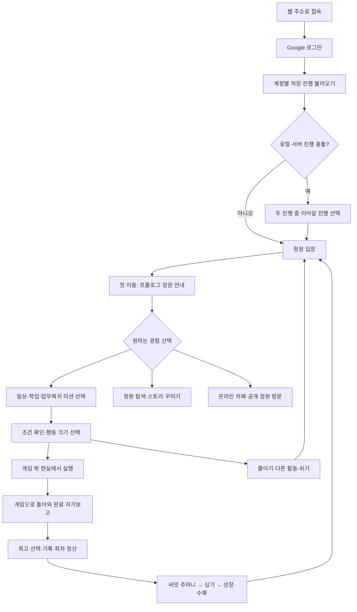
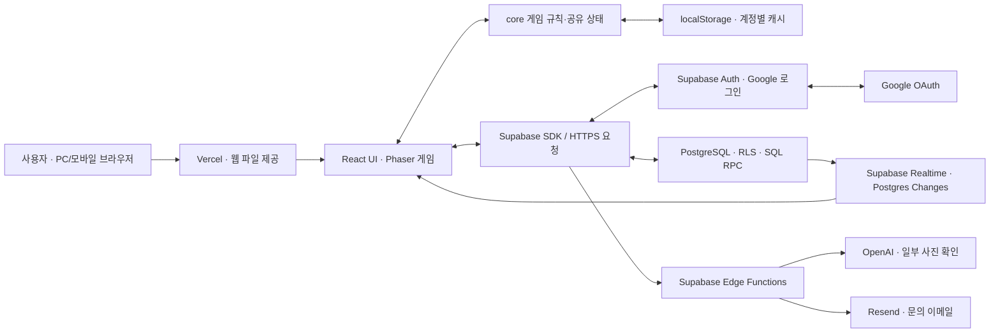

# 틈새정원 · 식물집사 서비스 플로우와 기술 구조

발표 준비용 · 작성일 2026-11-27 · 현재 로컬 코드 기준

> 구현 구조를 설명하는 자료다. 운영 배포 여부와 사용자 테스트 결과는 별도로 확인한다.
> 과거 문서에 남은 Expo·게스트·로컬 전용 설명보다 현재 웹 코드를 기준으로 정리했다.

## 1. 서비스 소개

작은 현실 활동을 선택하고 실행·기록한 경험을 게임 속 정원의 성장과 연결하는 2D 웹게임이다.
사용자는 자신에게 맞는 크기의 행동을 고르고, 부담스러우면 줄이거나 바꾸거나 쉴 수 있다.
게임은 상담·진단·치료를 제공하지 않으며 건강 개선 효과를 보장하지 않는다.

**발표용 한 문장**

“현실에서 해본 작은 행동을 정원에 남기고, 쉬었다가도 다시 시작할 수 있도록 돕는 웹게임입니다.”

## 2. 핵심 사용자 플로우



- 기존 이용자는 저장한 진행을 이어간다. 프롤로그를 매번 처음부터 보지 않는다.
- 로그인 전에는 게임을 시작하지 않는다. 초기 저장 불러오기가 끝나야 진입한다.
- 정원과 이야기를 먼저 보고 미션은 나중에 골라도 된다.
- 하루 실제 행동 완료는 최대 3개다. 계획 저장만으로 완료나 보상을 만들지 않는다.
- 미션 보상은 수행 기록이 있는 회차를 마칠 때 씨앗 주머니 한 번이다. 카드마다 중복 지급하지 않는다.
- 쉬기·보류·축소는 정상 선택이다. 미접속으로 식물이 죽거나 재화가 사라지지 않는다.

### 미션 화면에서 사용자가 보는 것

| 순서 | 화면·행동 | 의미 |
|---|---|---|
| 1 | 일상 / 학업 / 업무복귀 선택 | 오늘의 영역이며 고정 프로필이 아님 |
| 2 | 현재 상황·미션 카드 확인 | NPC 초상화·대사·추천 상황·실행 조건 표시 |
| 3 | 조금 해볼 만할 때 / 이것도 버거울 때 | 같은 활동의 기본·축소 중 선택 |
| 4 | 현실에서 선택 행동 실행 | 게임 속 이동 자체를 현실 퀘스트 완료로 보지 않음 |
| 5 | 완료 표시·회고 선택 | 수행은 자기보고 방식이며 개인 작성 내용은 통계로 보내지 않음 |
| 6 | 회차 종료·주머니·심기 | 실제 행동과 게임 안 변화를 연결 |

90개 미션 정의는 코드의 JSON에 있고, 선택·실행·완료 진행은 계정 저장본에 들어간다.
직접 미션 만들기, 다음 행동 책갈피, 하루 미션 배치도 지원한다.

### 정원·스토리·공간 이용

- 새싹이가 느리·모루·피오를 만나 같은 정원을 다르게 바라본 지도를 접한다.
- 느리는 큰 나무·돌 등 관찰 지점, 모루는 길, 피오는 가려진 영역을 중심으로 표현한다.
- 지도판에서 여러 지도를 함께 둘 수 있음을 발견하고, 사용자가 남길 방식을 선택하는 흐름이다.
- 핵심 메시지는 “자신에게 맞는 길은 다를 수 있고, 언제든 바꿀 수 있다.”이다.
- 미션 완료·희귀 씨앗·상점 구매를 메인 스토리의 필수 잠금 조건으로 삼지 않는다.
- 야외 정원, 집 내부, 모루 상점, 카페, 학교·직장 공간을 이용한다.
- 꾸미기는 정해진 야외 정원 구역과 자기 집 내부에서 지원한다.

## 3. 전체 시스템 구조



**백엔드가 없는 구조가 아니다.** Supabase가 인증·DB·실시간 연결을 제공하며,
게임에 필요한 서버 검사는 SQL 함수와 Edge Functions로 구현했다.
별도로 운영하는 Express/NestJS 서버는 없다.

## 4. 프런트엔드와 UI 기술

| 구분 | 기술 | 프로젝트에서 맡는 역할 |
|---|---|---|
| 개발 언어 | TypeScript strict | 상태·데이터·이벤트·서버 요청 타입 정의 |
| UI 프레임워크 | React 18 | 로그인, HUD, 미션, 가방, 설정, 상점, 통계, 문의 화면 |
| 게임 프레임워크 | Phaser 3 | 배경, 캐릭터 이동, NPC, 가구·식물, 공간 전환, 연출 |
| 빌드 도구 | Vite 8 | 개발 서버와 배포용 번들 생성 |
| 스타일 | CSS·게임 아트 에셋 | 정원 분위기의 패널·버튼·말풍선과 반응형 배치 |
| 상태 관리 | 직접 구현한 store | React와 Phaser가 같은 게임 상태를 참조 |
| 화면 간 연결 | 타입 있는 내부 이벤트 버스 | UI와 게임 Scene 사이의 명령·알림 전달 |
| 기기 저장 | localStorage | 계정별 진행 캐시와 충돌 복구용 로컬 백업 |
| 서버 연결 | supabase-js 2 / fetch | Auth, REST/RPC, Realtime, Edge Function 호출 |

게임 화면은 Phaser Canvas이고, 메뉴·입력·모달은 그 위에 배치한 React DOM이다.
React UI 조작이 뒤쪽 Phaser 입력으로 전달되지 않도록 입력 우선순위를 처리한다.
주요 기준 화면은 가로 844×390이며 창 비율에 따라 무대 높이·배율을 조절한다.
현재 구현은 Flutter·React Native 앱이 아닌 브라우저 기반 웹게임이다.

### 코드 폴더의 역할

```text
src/main.tsx       앱 시작·Phaser 생성·인증에 따른 게임 진입
src/core/          게임 규칙·상태·미션 데이터·저장 해석·순수 계산
src/scene/         Phaser 정원·실내·온라인 카페·방문 장면
src/ui/            React UI·모달·미션 흐름·사용자 입력
src/lib/           인증·계정 저장 동기화·카페 연결·통계·서버 요청
src/styles/        게임 위 UI의 CSS
supabase/          DB 마이그레이션·권한 테스트·Edge Functions·운영 안내
public/assets/     게임에서 제공하는 이미지·오디오 등 에셋
```

게임 화면을 연결하는 `src/core/events.ts`와 이용 통계를 수집하는 `src/lib/events.ts`는 서로 다르다.

## 5. 백엔드와 데이터베이스

| 구성 | 역할 |
|---|---|
| Supabase Auth | Google OAuth와 로그인 세션 관리 |
| PostgreSQL | 정원 저장, 카페 상태, 공개 동의, 통계 데이터 보관 |
| JSONB | 사용자별 전체 게임 상태를 하나의 구조화된 문서로 저장 |
| RLS | 로그인 UID 기준으로 허용한 행만 읽고 변경하도록 제한 |
| SQL RPC | 저장 충돌 검사, 카페 이동·좌석 검사, 안전한 공개 조회, 팀 통계 집계 |
| Realtime | 카페 좌표 변경을 다른 접속자에게 전달 |
| Edge Functions | 외부 API 호출·이메일 발송 등 서버 비밀 값이 필요한 처리 |

### 실제 사용하는 주요 테이블

| 테이블 | 저장 내용 | 접근 방식 |
|---|---|---|
| `auth.users` | 인증 사용자 UID와 제공자 정보 | Supabase Auth 관리 영역 |
| `garden_saves` | 계정별 최신 게임 JSON·revision·request_id·저장 시각 | 본인 조회, 저장 RPC로 쓰기 |
| `garden_sharing` | 다른 사용자의 정원 방문 허용 여부 | 본인 설정 |
| `cafe_members` | 카페 이용자의 좌표·정원 이름·좌석·최근 갱신 시각 | 제한된 조회, RPC로 본인 갱신 |
| `cafe_sessions` | 같은 계정의 여러 창을 구분하는 세션 토큰 | 서버 함수 내부에서 관리 |
| `events` | 접속·미션 조회·완료·쉬기 이벤트 | 검증된 RPC로 기록, 집계에 사용 |
| `analytics_team` | 팀 통계 열람 권한을 가진 UID | 관리자가 지정, 서버에서 권한 확인 |
| `analytics_event_keys` | 분석 이벤트 중복 방지 키 | 서버 내부 관리 |
| `analytics_acquisition` | 최초 유입 source·medium·campaign | 최초 접속 수집 시 서버 기록 |

과거 PRD의 `profiles / missions / activities / plans`가 모두 현재 DB에 구현됐다고 설명하지 않는다.
현재 90개 미션의 원본은 `src/core/data/missions-v2.json`이며 사용자 진행은 `garden_saves.state`에 저장한다.

### 게임 JSON에 포함되는 것

정원 이름·텃밭·식물·야외/실내 가구·좌우 방향·창고·씨앗·열매·미션 진행·직접 계획·
완료 기록·회고·이야기·탐색·방문 보상·설정 등이 포함된다.

JSONB는 MVP에서 전체 진행을 함께 저장·복원하기 쉽다는 장점이 있다.
반면 일부 필드 변경에도 큰 스냅샷을 보내고, 구조 변경과 동시 수정 관리가 필요하다.
그래서 분석 데이터와 카페 접속 상태는 별도 테이블로 분리했다.

## 6. 자동 저장과 충돌 처리

```text
사용자 행동 → store 갱신 → 계정별 로컬 캐시 저장
                           ↓
                   약 600ms 후 서버 저장 요청
                           ↓
          UID·Google 인증·입력·예상 revision 검사
                    ┌──────┴──────┐
                 일치              불일치
          최신 state 저장       덮어쓰기 중단
          revision 증가         서버 진행 재조회
                               로컬/서버 선택 안내
```

예: 휴대폰과 PC가 revision 5를 읽었다. 휴대폰이 저장하면 서버는 6이 된다.
PC가 5를 기준으로 저장하면 충돌을 감지하고, 같은 계정의 두 진행 중 이어갈 쪽을 선택한다.
계정을 고르는 것이 아니며 두 진행을 자동 합치거나 재화를 합산하지 않는다.

- 서버는 기본적으로 계정별 최신 state 한 개를 보관한다. revision별 전체 이력은 없다.
- 복원·충돌 선택 시 로컬 백업을 남기지만 브라우저 데이터 삭제를 견디는 운영 백업은 아니다.
- 계정 변경 전 요청의 늦은 응답을 새 계정에 적용하지 않는다.
- RLS는 타인 접근을 제한한다. 본인이 보낸 전체 JSON의 게임 규칙까지 모두 검증하는 것은 아니다.
- 재화와 보상 전체가 서버 원장 기반인 구조로 설명하지 않는다.

## 7. 온라인 카페와 정원 방문

```text
A의 캐릭터 이동
  → cafe_step RPC (이동 중 최대 0.5초마다)
  → 서버에서 UID·공간 경계·좌석 등 검사
  → cafe_members 최신 좌표 갱신
  → Realtime Postgres Changes
  → B의 화면에서 위치를 보간해 A 캐릭터 표시
```

- 이동 경로 전체를 쌓지 않고 사용자별 최신 좌표를 갱신한다.
- 멈춰 있어도 10초마다 상태를 갱신하며, 30초 동안 갱신이 없으면 접속자 표시에서 제외한다.
- 좌석은 서버의 거리 검사와 UNIQUE 제약으로 한 명만 확정한다.
- 동일 계정의 이전 창 요청이 새 창의 상태를 덮어쓰지 않도록 세션을 구분한다.
- 현재는 Presence/Broadcast 대신 Postgres Changes를 사용한다.
- 소규모 테스트용이며 동시 접속이 늘면 DB 쓰기량·지연·비용을 측정해야 한다.

다른 캐릭터 선택 → 정원 보러가기 → 공개 동의 확인 → 표시용 데이터만 조회 → 읽기 전용 방문.
전체 저장 JSON·회고·개인 계획·가방·재화는 방문자에게 전달하지 않는다.
방문 중에도 내 정원 저장본과 revision은 변경하지 않는다.

## 8. 문의·후기와 사진 확인

### 문의·후기

```text
설정 → 유형·내용 입력 → 전달 동의
  → send-feedback Edge Function
  → Google 세션 확인 → Resend API → 팀 운영 메일함
```

문의에서 답변받기를 선택한 경우에만 서버가 확인한 Google 이메일을 Reply-To로 전달한다.
게임 저장본·회고를 자동 첨부하지 않고 문의 원문을 통계 이벤트로 수집하지 않는다.
사용자가 실제 이메일 수신·답장 대상 동작을 확인했다.

### 선택형 사진 확인 기반

```text
getUserMedia 카메라 → JPEG 촬영·미리보기
  → verify-activity Edge Function → OpenAI 이미지 확인
  → 결과 안내 → 재촬영 또는 건너뛰기
```

기존 일부 활동에 연결된 기능이다. **현재 새 90개 미션 전체에 사진 검사가 연결된 상태는 아니다.**
이미지의 시각적 단서를 확인하며 실제 방문·시간·수행 사실을 완전히 증명하지 않는다.
사진을 게임 저장 DB에 보관하지 않고 API 키는 서버 Secrets에서 관리한다.

## 9. 팀 통계와 측정 범위

로그인과 초기 진행 불러오기가 끝난 뒤 접속을 기록한다.
현재 수집 경로는 `app_opened`, `mission_viewed`, `activity_completed`, `rested`다.

| 지표 | 계산 기준 |
|---|---|
| 기간 이용자 | 선택 기간에 접속한 서로 다른 UID 수 |
| 신규 이용자 | 해당 기간에 첫 접속 기록이 측정된 UID 수. 실제 가입일과 다를 수 있음 |
| 활동 완료 이용자 | 기간 중 실제 행동 완료 이벤트가 한 번 이상 있는 UID 수 |
| D1 / D7 / D14 | 첫 측정일로부터 정확히 1/7/14일 뒤에 다시 접속한 비율 |
| 최초 유입 | 로그인 전 확보한 UTM 중 검증된 source·medium·campaign을 최초 접속에 연결 |

팀 통계 권한을 등록한 계정은 집계에서 제외한다. 지표 계산의 날짜는 Asia/Seoul 기준이다.
로그인 전 웹 방문과 정확한 플레이 시간은 현재 측정하지 않는다.

**발표 수치 확인:** 내부 테스트용 가상 계정은 일반 통계에서 자동 제외되지 않는다.
발표에 실제 이용 수치를 넣기 전 `auth.users.raw_user_meta_data`의 `fixture_batch`/`synthetic` 등
식별자로 제외해야 한다. 유입 source를 direct로 바꿨더라도 가상 데이터가 실제 측정으로 바뀌지는 않는다.
이 문서에는 이용자 수·효과 수치를 기재하지 않았다.

## 10. 배포·개발 협업·검증

```text
기본 브랜치에서 작업 브랜치 생성
  → 구현·로컬 검사 → 커밋·push → PR
  → GitHub Actions·팀원 리뷰 → 승인 후 병합
  → Vercel 기본 브랜치 배포
```

- 기본 브랜치 이름: `s0-web-demo-base`.
- Vercel은 Vite 빌드 결과인 `dist`를 제공한다. DB와 Edge Function은 Supabase에서 운영한다.
- DB 마이그레이션 적용과 Edge Function 배포는 프런트엔드 배포와 별도다.
- 공개 환경 변수는 Supabase URL과 anon key 두 개만 선택해서 전달한다.
- OpenAI·Resend 키는 Supabase Edge Function Secrets에 두며 브라우저 번들에 넣지 않는다.
- Vitest는 순수 게임 규칙·저장·호환성 등을 검사한다. 린트는 Oxlint, 타입 검사는 TypeScript다.
- 기존 `app`·`secrets` CI와 별도로 DB 검증을 보완하는 작업을 진행했다.

### 아직 배포 상태와 구분해야 하는 로컬 보완

2026-11-27의 `s0-migration-readiness` 로컬 작업에는 저장 형식용 `saveSchemaVersion`,
신규 SQL, DB CI, 공식 CLI 전체 타입 생성, 업그레이드·합성 저장본 백업/복원 도구가 포함돼 있다.
이 작업의 코드 작성·로컬 검증과 운영 적용은 별개이며, PR 병합·운영 DB 반영 여부를 발표 전에 확인한다.
로컬에서 앱 테스트 297개, 도구 테스트 2개, 실제 Supabase SQL 테스트 6개와 복원 연습을 통과했다.
운영 이력·백업·새 프로젝트 전체 복원은 별도 확인 사항이다.

## 11. 발표 슬라이드 구성 제안

| 장 | 제목 | 넣을 핵심 |
|---|---|---|
| 1 | 현실의 작은 행동을 정원에 남기기 | 서비스 목적과 실제 플레이 장면 |
| 2 | 사용자 이용 흐름 | 로그인 → 활동 선택 → 현실 실행 → 기록 → 정원 변화 |
| 3 | 웹 UI와 게임 화면의 결합 | React 패널 + Phaser Canvas 화면 |
| 4 | 전체 기술 구조 | Vercel / 브라우저 / Supabase / 외부 API 구조도 |
| 5 | 계정 저장과 데이터 보호 | JSONB·UID·RLS·revision 충돌 예시 |
| 6 | 온라인 카페 | RPC → DB → Realtime → 다른 화면 |
| 7 | 테스트와 개선 | 문의·피드백, 검증 범위, 확인된 한계 |

### 기술 구조 1분 설명 예시

“프런트엔드는 React와 Phaser를 함께 사용했습니다. 로그인과 미션·설정 화면은 React로,
정원과 캐릭터 이동은 Phaser로 만들고 공유 상태와 이벤트로 연결했습니다.
백엔드는 Supabase를 사용해 Google 로그인, PostgreSQL 저장, 실시간 카페를 구현했습니다.
게임 진행은 계정별 JSONB로 저장하며, UID와 RLS로 다른 사용자의 데이터 접근을 제한합니다.
여러 기기 저장이 충돌하면 revision으로 감지하고 사용자가 이어갈 진행을 선택합니다.
카페는 좌표를 RPC로 갱신하고 Realtime으로 다른 화면에 전달합니다.
웹 배포는 Vercel을 사용하고, 외부 API 키가 필요한 처리는 Edge Function에서 수행합니다.”

## 12. 상세 구현 확인 경로

- 앱 진입: [src/main.tsx](src/main.tsx), [SessionGate](src/ui/SessionGate.tsx)
- 게임 규칙·미션: [missions.ts](src/core/missions.ts), [미션 JSON](src/core/data/missions-v2.json)
- 계정 저장: [gardenSync.ts](src/lib/gardenSync.ts), [gardenRepository.ts](src/lib/gardenRepository.ts)
- 온라인 연결: [cafe.ts](src/lib/cafe.ts), [카페 안내](supabase/CAFE_SETUP.md)
- 이용 통계: [events.ts](src/lib/events.ts), [통계 안내](supabase/TEAM_ANALYTICS_SETUP.md)
- 문의: [피드백 안내](supabase/FEEDBACK_SETUP.md)
- SQL·이관·복원: [MIGRATIONS.md](supabase/MIGRATIONS.md), [마이그레이션 폴더](supabase/migrations/)
